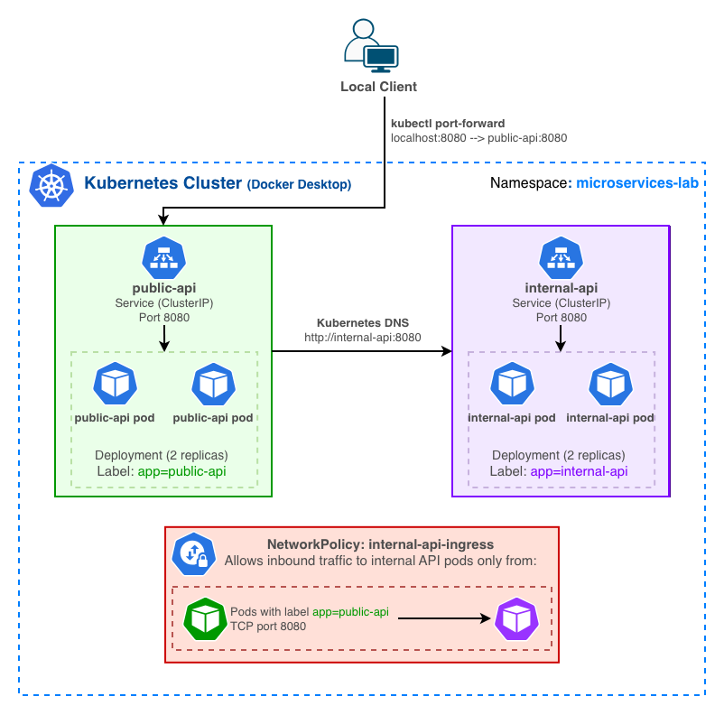

# Kubernetes Microservices Architecture & Network Security Lab

A hands-on Kubernetes project deploying two containerized Python Flask services, demonstrating service discovery, workload scaling, pod recovery, health checks, resource management, and network access controls.

This project adapts two applications originally developed for a Google Cloud Run modernization project to a local Kubernetes environment.

## Architecture



Both applications run as Kubernetes Deployments in the `microservices-lab` namespace.

- **Public API:** Receives client requests and retrieves orders from the internal API.
- **Internal API:** Returns sample order data through an internal endpoint.
- **ClusterIP Services:** Provide stable service endpoints and Kubernetes DNS-based discovery.
- **NetworkPolicy:** Restricts inbound connections to internal API pods to pods labeled `app=public-api` on TCP port 8080.

## Technologies

- Kubernetes (Docker Desktop, kind-based local cluster)
- Docker
- Python and Flask
- Kubernetes Deployments and Services
- Kubernetes NetworkPolicy
- Kubernetes DNS
- Readiness and liveness probes
- CPU and memory resource requests and limits

## Project Structure

```text
kubernetes-microservices-lab/
├── apps/
│   ├── public-api/
│   │   ├── app.py
│   │   ├── Dockerfile
│   │   └── requirements.txt
│   └── internal-api/
│       ├── app.py
│       ├── Dockerfile
│       └── requirements.txt
├── k8s/
│   ├── public-api.yaml
│   ├── internal-api.yaml
│   └── internal-api-networkpolicy.yaml
├── docs/
│   └── architecture.png
└── README.md
```

## Local Deployment

### 1. Prerequisites

- Docker Desktop with Kubernetes enabled
- `kubectl`
- Access to a local Kubernetes cluster

The steps below use locally built images. The cluster must have access to these images before deploying.

### 2. Build Docker Images

From the repository root:

```bash
docker build -t public-api:v1 ./apps/public-api
docker build -t internal-api:v1 ./apps/internal-api
```

For a kind-based cluster using a separate containerd image store, import the images into the Kubernetes node before deploying. Image-loading procedures vary by local Kubernetes configuration.

The manifests use `imagePullPolicy: Never` because this project uses locally imported images.

### 3. Create the Namespace

```bash
kubectl create namespace microservices-lab
```

If the namespace already exists, this step can be skipped.

### 4. Deploy the Applications and NetworkPolicy

```bash
kubectl apply -f k8s/
```

This applies the Kubernetes manifests for the public API, internal API, and NetworkPolicy.

### 5. Verify the Workloads

```bash
kubectl get pods -n microservices-lab
kubectl get services -n microservices-lab
kubectl get networkpolicy -n microservices-lab
```

Both application Deployments are configured with two replicas.

### 6. Test the Application

Forward the public API Service to your local machine:

```bash
kubectl port-forward -n microservices-lab svc/public-api 8080:8080
```

In another terminal, verify the health endpoint:

```bash
curl http://localhost:8080/health
```

Expected response:

```text
ok
```

Then retrieve sample orders:

```bash
curl http://localhost:8080/api/orders
```

The public API calls the internal API through its Kubernetes Service and returns the sample order data.

## Kubernetes Validation

The following tests were performed on a local Docker Desktop Kubernetes cluster.

### Service-to-Service Communication

Verified that the public API successfully retrieved order data from the internal API using Kubernetes DNS and the internal API ClusterIP Service.

The public API uses the internal Service endpoint:

```text
http://internal-api:8080
```

This allows communication through Kubernetes service discovery rather than relying on individual pod IP addresses.

### Horizontal Scaling

Scaled the public API Deployment from two replicas to four:

```bash
kubectl scale deployment public-api --replicas=4 -n microservices-lab
```

Verified the Deployment and running pods:

```bash
kubectl get deployment public-api -n microservices-lab
kubectl get pods -n microservices-lab
```

Confirmed that all four replicas became ready and the API continued responding successfully.

After testing, restored the Deployment to two replicas:

```bash
kubectl scale deployment public-api --replicas=2 -n microservices-lab
```

### Pod Recovery

Deleted a running public API pod while the Deployment was configured for four replicas.

Kubernetes created a replacement pod to restore the desired replica count.

A subsequent request to the public API returned the expected order data.

This demonstrated Kubernetes Deployment reconciliation and pod replacement in the local environment.

### NetworkPolicy Validation

Applied a NetworkPolicy named `internal-api-ingress` to restrict inbound traffic to internal API pods.

The policy allows:

- **Destination:** Pods labeled `app=internal-api`
- **Source:** Pods labeled `app=public-api` in the same namespace
- **Protocol:** TCP
- **Port:** 8080

Two connectivity tests were performed.

**Test 1: Authorized Communication**

The public API successfully retrieved order data from the internal API:

```bash
curl http://localhost:8080/api/orders
```

The request completed successfully.

**Test 2: Unauthorized Communication**

Created a temporary BusyBox pod without the permitted `app=public-api` label and attempted to access the internal API:

```bash
kubectl exec -n microservices-lab network-test -- \
  wget -T 5 -O - http://internal-api:8080/health
```

The request timed out:

```text
Connecting to internal-api:8080
wget: download timed out
```

The results were consistent with the intended NetworkPolicy behavior: traffic from the permitted public API pods succeeded, while traffic from the test pod was blocked.

These tests validate the observed behavior in the local cluster but do not establish broader production security guarantees.

### Health Checks and Resource Management

Both application Deployments include HTTP readiness and liveness probes using the `/health` endpoint.

- **Readiness probes:** Check whether application containers are ready to receive traffic.
- **Liveness probes:** Check whether application containers remain healthy and should be restarted if their checks repeatedly fail.
- **Resource requests:** Specify CPU and memory resources requested for scheduling.
- **Resource limits:** Define maximum CPU and memory allocations for the containers.

The manifests configure:

| Resource | Request | Limit |
|---|---|---|
| CPU | 50m | 250m |
| Memory | 64Mi | 256Mi |

These settings were configured as part of the lab; resource utilization and performance were not benchmarked.

## Security and Limitations

This is a local learning and validation project, not a production deployment.

- The public API uses `AUTH_MODE=local` for testing, which disables the Google Cloud identity-token authentication used in the original Cloud Run application.
- Kubernetes NetworkPolicy restricts network traffic based on pod selectors and ports but does not replace application-level authentication or authorization.
- Both applications use ClusterIP Services. The public API is accessed locally through `kubectl port-forward`.
- The internal API returns static sample order data rather than querying a database.
- The project does not implement GPU scheduling, distributed AI inference, or production high availability.
- Scaling and pod recovery were tested manually. No performance benchmarks or uptime measurements were conducted.

## Future Improvements

- Add automated deployment validation and integration tests.
- Explore Kubernetes Horizontal Pod Autoscaling.
- Add application metrics and observability.
- Extend the project with an event-driven worker architecture.
- Evaluate Kubernetes deployment options for AI inference workloads.